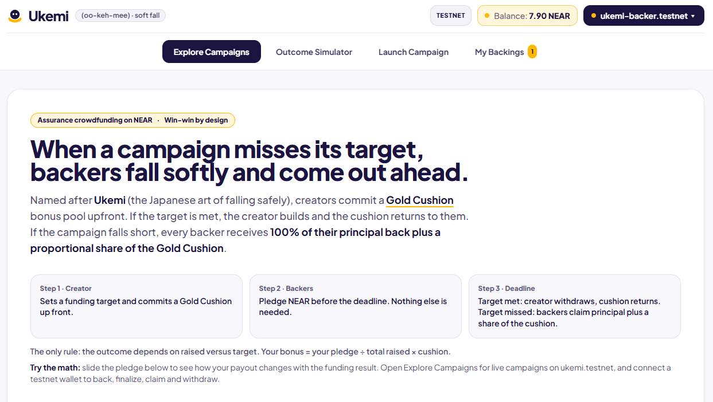
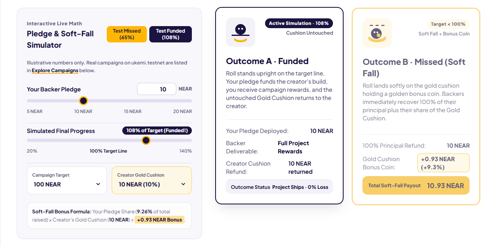
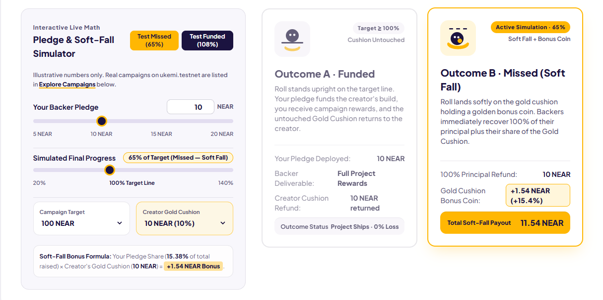
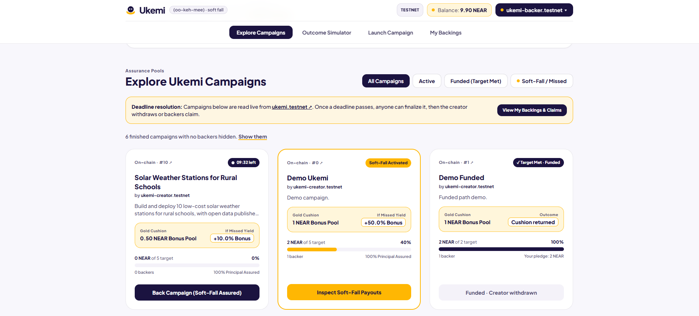
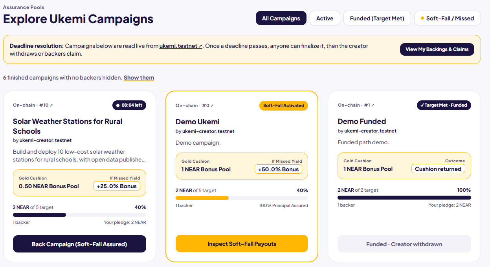
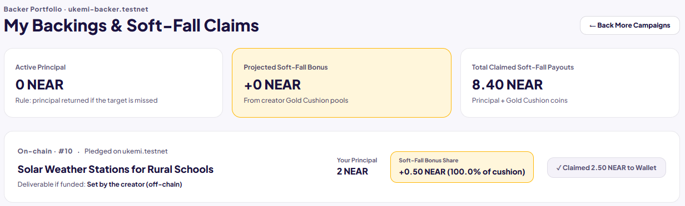

# Ukemi (oo-keh-mee): soft-fall crowdfunding on NEAR

Ukemi is an assurance crowdfunding contract on NEAR testnet. If a campaign misses its target, backers get **their principal back (less a small one-time storage fee) plus a share of the creator's Gold Cushion**. If it reaches the target, the creator withdraws the funds and the cushion.

Built for **NEAR HACKATHON 2026**.

- Live demo: https://rafysetyo.github.io/ukemi/frontend/
- Contract (testnet): `ukemi.testnet`
- Frontend: single file, `frontend/index.html`, no build step
- Full soft-fall flow already run on testnet with the current contract: see [Proof on testnet](#proof-on-testnet)

## How it works

Outcome rule: only `raised` versus `target`, decided once after the deadline.

| Outcome | Backer receives | Creator receives |
|---|---|---|
| Funded (raised >= target) | Project rewards, delivered off-chain by the creator | Raised amount + Gold Cushion |
| Missed (raised < target) | Principal + `pledge / raised * cushion` | Nothing from pledges. If there are no backers, the cushion comes back |

**Storage fees.** Records are never deleted, so the contract keeps the storage cost of each new record out of the attached deposit. The cushion is the creator's deposit minus the campaign record's fee, and a backer's pledge is their deposit minus the fee of their pledge record. Only an account's first pledge to a campaign pays a fee; later top-ups are free. In this README, "principal", "pledge" and "cushion" mean the amounts after those fees. The fees are small, a few thousandths of a NEAR (see the example below).

Example from the live run (campaign #12): the only pledge was 2 NEAR (0.00085 NEAR fee, 1.99915 NEAR credited), the creator attached a 0.5 NEAR cushion (0.00495 NEAR fee, 0.49505 NEAR credited), the 5 NEAR target was missed, and the backer claimed **2.4942 NEAR (+24.7% on the 2 NEAR sent)**.

## Why it matters

On-chain crowdfunding locks backers' funds until the deadline, and a failed campaign leaves them with nothing for that wait. Ukemi asks the creator to put something behind the campaign. The Gold Cushion is posted before the first pledge. If the target is missed, it is paid to the backers. If the target is met, it goes back to the creator.

- **Backers:** a missed campaign pays them (principal plus a share of the cushion) instead of only returning their money.
- **Creators:** a visible, on-chain signal of confidence. A creator who expects to reach the target gets the cushion back.
- **Everyone:** the contract takes no protocol fee (users only cover the small on-chain storage cost of the records they create), and every outcome is decided by one public rule, `raised` versus `target`.

The cushion is a confidence signal and a consolation payment, not a delivery guarantee. See [Failure cases and limits](#failure-cases-and-limits). NEAR's low fees make small pledges practical, and its readable account names make the pledge history easy to follow.

## Try it in 3 minutes

No wallet is needed for steps 1 to 3.

1. Start the frontend:
   ```
   cd frontend
   python3 -m http.server 8082
   ```
   Open http://localhost:8082. It needs internet access, because Tailwind, the wallet library and the fonts load from CDNs.
2. Open **Outcome Simulator**. With a 100 NEAR target, a 10 NEAR Gold Cushion and a 10 NEAR pledge, move the "Simulated Final Progress" slider to **65%**. You should see **Total Soft-Fall Payout 11.54 NEAR**, made of the 10 NEAR principal plus a **+1.54 NEAR** bonus (15.38% of the cushion pool). Move the slider to **108%** and the "Funded" outcome lights up instead. The simulator ignores the small storage fee.
3. Open **Explore Campaigns**. Campaigns are read live from `ukemi.testnet`. Campaign **#12** ("Open-Source Flood Sensors for Riverside Villages") shows *Soft-Fall Activated*, and campaign **#1** shows *Target Met · Funded*.
4. To run the full flow yourself, use two NEAR testnet accounts, because a creator cannot back their own campaign:
   1. Connect account A and use **Launch Campaign** with a short duration (the form takes minutes, and there is a **10 min** shortcut) and a Gold Cushion.
   2. Switch to account B and back the campaign from **Explore Campaigns**.
   3. Wait for the deadline, then press **Finalize** on the campaign card.
   4. Open **My Backings** as account B and claim. If the target was missed, you receive your principal plus the bonus.

## Contract

| Method | Who | What |
|---|---|---|
| `create_campaign(title, description, target, duration_minutes)` payable | creator | Attached deposit minus the campaign's storage fee is the Gold Cushion. Title up to 80 bytes, description up to 500 bytes, duration up to 30 days. Minutes, so demos can end in minutes. |
| `back(campaign_id)` payable | backer | Attached deposit is the pledge (minus the storage fee on an account's first pledge to the campaign). Allowed until the deadline. |
| `finalize(campaign_id)` | anyone | After the deadline: `Funded` if raised >= target, else `Missed`. |
| `claim_refund(campaign_id)` | backer | Missed only: principal + pledge / raised * cushion. |
| `withdraw(campaign_id)` | creator | Funded: raised + cushion. Missed with no backers: cushion back. |

Views: `get_campaign_count`, `get_campaign`, `get_campaigns(from_index, limit)`, `get_pledge`, `get_claimable`.

Amounts are yoctoNEAR strings (1 NEAR = 10^24). Bonus uses floor division, so a few yocto of dust can stay in the contract.

`claim_refund` and `withdraw` mark the entry as paid first, then send the transfer. A private callback undoes the mark if the transfer failed, so the payout can be claimed again.

Known limits are listed in [Failure cases and limits](#failure-cases-and-limits).

### Test and build
```
cargo test                               # 17 unit tests
cargo near build non-reproducible-wasm   # needs cargo-near
```

### Deployed contract

Live on NEAR testnet as `ukemi.testnet`. Current code: SHA-256 (base58) `H9k69C8hKPkBsVSmmhTAGf5k2bCeBHz5VfA2z3JFAAQ`, deployed in [this transaction](https://testnet.nearblocks.io/txns/HprB7GSomSNrWL2VffaHmrZ1NFa5WqBrGHChDPvBQnU3). The build is non-reproducible, so rebuilding locally may give a different hash.

Campaigns #0 to #11 were created with the previous version of the contract, which charged no storage fee, so their amounts are round numbers. Campaign #12 onward use the current version.

## Frontend

`frontend/index.html` is a single-file web app (no build step) for exploring campaigns, simulating payouts, launching campaigns, and backing, finalizing, claiming and withdrawing.

It reads campaigns directly from `ukemi.testnet` over public testnet RPC endpoints, so browsing works without a wallet. Sending transactions needs a NEAR testnet wallet, connected through `@hot-labs/near-connect`.

## Screenshots

| | |
|---|---|
| **Landing** |  |
| **Outcome Simulator, funded (108%)** |  |
| **Outcome Simulator, missed (65%)** |  |
| **Explore, before pledge** |  |
| **Explore, after pledge** |  |
| **My Backings, after claim** |  |

Screenshots were taken during the earlier run (campaign #10, previous contract version). The current run is documented in [Proof on testnet](#proof-on-testnet).

## Proof on testnet

### Current contract: campaign #12

The full missed-target flow, run end to end against `ukemi.testnet` with the current contract. Campaign #12, "Open-Source Flood Sensors for Riverside Villages", was launched from the frontend by `ukemi-creator.testnet` with a 5 NEAR target, a 0.5 NEAR cushion and a 10 minute duration. The backer `ukemi-backer.testnet` pledged 2 NEAR, the target was missed, and the backer claimed 2.4942 NEAR. The backer's account balance went from 10.8906 to 11.3840 NEAR across the flow (+0.4934 NEAR: the 0.4942 NEAR net gain minus about 0.0008 NEAR of gas), which confirms the payout transfer arrived.

| Step | Method | Transaction |
|---|---|---|
| Back campaign (2 NEAR, 0.00085 NEAR storage fee) | `back` | [view](https://testnet.nearblocks.io/txns/82VmUbP1g8PEoiUAdBgB9b9cQXczKW5KWXniQ6qkPXZJ) |
| Finalize after deadline | `finalize` | [view](https://testnet.nearblocks.io/txns/4yMnjUQEdcU56tEvAdmPBWKRfYF1iKCAbBfhqjPkKN4c) |
| Claim principal + bonus (2.4942 NEAR) | `claim_refund` | [view](https://testnet.nearblocks.io/txns/APaMzMujGE7uGJkUmKg7mNsugapwee9j2SwT73zPCUNd) |

The nearblocks pages show the time of each transaction.

### Earlier run: campaign #10 (previous contract version, no storage fee)

The same flow against the previous version of the contract (campaign #10, "Solar Weather Stations for Rural Schools"). The backer pledged 2 NEAR, the target was missed, and the backer claimed 2.50 NEAR (100% principal plus the 0.50 NEAR Gold Cushion bonus, +25%).

| Time (UTC) | Step | Method | Transaction |
|---|---|---|---|
| 2026-11-10 19:03:19 | Back campaign (2 NEAR) | `back` | [view](https://testnet.nearblocks.io/txns/3PNoHPSmnyBiThGhkJbbCRDxaNXDnS3WiK5oauzcKfTz) |
| 2026-11-10 19:12:33 | Finalize after deadline | `finalize` | [view](https://testnet.nearblocks.io/txns/6hyBjwVoBgnpdXUBHtfjbBhBaC8E8U8xaJFaqc1SeUhX) |
| 2026-11-10 19:15:12 | Claim principal + bonus | `claim_refund` | [view](https://testnet.nearblocks.io/txns/HRR2fS6Pw4sKV7onc1ddcRfJsmWfrb8Dres12wWg2Dg6) |

Transaction screenshots: [pledge](docs/screenshots/07-tx-pledge.png), [finalize](docs/screenshots/08-tx-finalize.png), [claim](docs/screenshots/09-tx-claim.png).

### Funded path

The funded path was run on testnet with the previous contract version: campaign #1 reached its target and the creator withdrew. With the current version, the funded payout is covered by a unit test (`funded_campaign_pays_creator_once`) and has not yet been run live.

## Failure cases and limits

Ukemi is a hackathon prototype on testnet. These are the known gaps, roughly in order of how much they matter.

**1. A creator can fund their own campaign from another account.**
The contract only rejects a pledge from the creator's own account. It has no identity or sybil resistance, so a second account the creator controls can pledge. That has two effects:

- *Forcing "Funded".* The creator can cover the shortfall to the target before the deadline, finalize, and withdraw `raised + cushion`. The topped-up money comes back with it, so the cushion is only at risk if the creator lets the campaign miss. Real backers then lose the refund and bonus they would have had.
- *Taking back part of the cushion.* On a missed campaign the bonus is pro-rata to pledges, so a creator-controlled pledge claims its share of the creator's own cushion.

`raised` shows how much was pledged, not how many independent people backed the project.

**2. Late pledges dilute the cushion.**
The bonus is `pledge / raised * cushion`, with no weight for time or risk, and principal is returned in full if the target is missed. A large pledge placed just before the deadline, kept below the target, takes most of the cushion. Example (storage fees ignored): target 100 NEAR, cushion 10 NEAR, one backer pledged 10 NEAR. A second account pledges 89 NEAR (raised 99, still below target). If the campaign misses, the late pledge claims 89 + 8.99 NEAR, and the first backer's bonus drops from 10 NEAR to 1.01 NEAR. The late pledger's only risk is that someone else tips `raised` over the target in the same window. This is not mitigated in this version.

**3. Delivery is not enforced on-chain.**
If the target is met, the creator can withdraw `raised + cushion` right after `finalize`. There are no milestones, no staged release and no dispute step, and the cushion returns to the creator, so it gives backers no protection after funding. "Deliverable if funded" is set by the creator and fulfilled off-chain.

**4. The escrow is only as trustless as the deployer account.**
The contract has no pause or upgrade logic, but pledges sit in the balance of `ukemi.testnet`. Whether that account still holds a full-access key, which could redeploy the code or move the balance, is a deployment detail the contract cannot enforce.

**5. A payout to a deleted account cannot succeed.**
`claim_refund` and `withdraw` mark the payout as done, send the transfer, and a private callback undoes the mark if the transfer failed, so the payout can be retried. If the receiving account no longer exists, every retry fails again and the funds stay in the contract.

**6. Refunds are net of a one-time storage fee.**
Records are never deleted, so each new campaign and each account's first pledge to a campaign pays for the storage it adds. The fee comes out of the attached deposit, which keeps spam from draining the contract balance. A backer's principal is therefore the deposit minus that fee (0.00085 NEAR in campaign #12), and the cushion is the creator's deposit minus the campaign fee (0.00495 NEAR in #12). "Principal back" holds for the amount credited, not for the amount sent.

**What the contract does enforce.** The outcome depends only on `raised` versus `target`, decided once after the deadline. Pledged funds leave the contract only through `claim_refund` (missed campaigns, once per backer) or `withdraw` (the creator, once). These rules have unit tests in `src/lib.rs`.

Testnet only, no real funds. The contract has not been audited.

## Roadmap

Each item answers one of the limits above, in rough priority order. None of this is built yet.

1. **Time-weighted bonus** (limit 2). Weight each pledge's share of the cushion by how long the pledge was locked, so a pledge placed just before the deadline earns little.
2. **Milestone-released cushion** (limit 3). After a campaign is funded, hold the cushion and release it to the creator as backers approve milestones, weighted by pledge size. A milestone that is not approved forfeits its part of the cushion to the backers. This turns the cushion from a consolation payment into a delivery incentive. The open design question is who confirms delivery.
3. **Raise the cost of self-funding** (limit 1). For example minimum pledge sizes and a delay before the creator can withdraw. Full sybil resistance needs an identity layer, which is out of scope for now.
4. **Hardening and mainnet** (limit 4). External audit, then remove the full-access key or move it to a multisig before any mainnet deployment.

## License

MIT. See [LICENSE](LICENSE).
